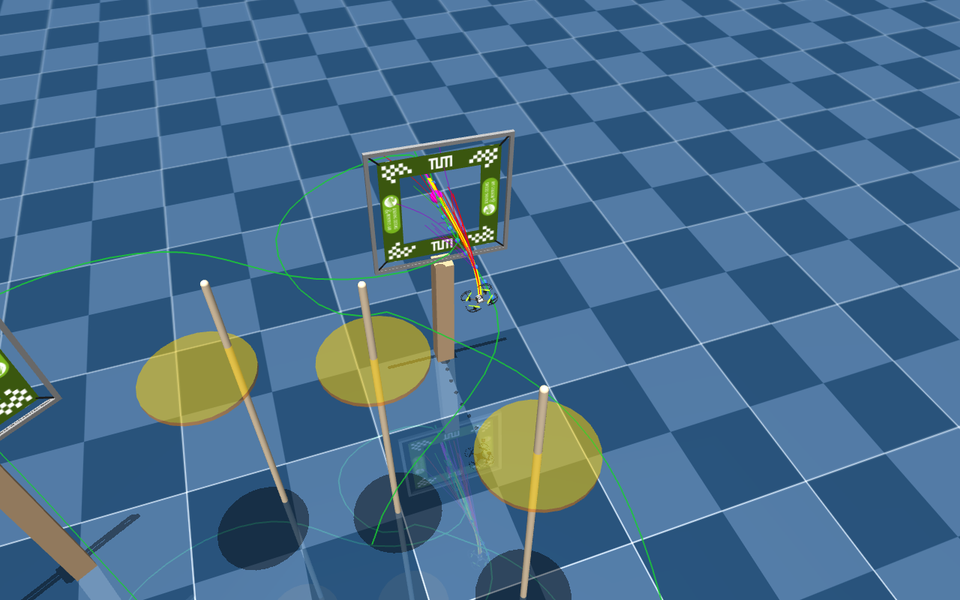

# control.mppi_controller

A basic **Model Predictive Path Integral (MPPI)** controller that races through fully randomized
tracks (level 3). It uses the collective thrust and attitude interface and runs on the CPU with JAX.

```bash
python scripts/sim.py --config level3.toml --controller mppi_controller.py --render True
```

!!! note
    The controller outputs attitude commands, so the config needs `control_mode = "attitude"` in its
    `[env]` section. `config/level3.toml` is already set up for this controller.

## How MPPI works

MPPI is a sampling-based MPC (Williams et al., *Model Predictive Path Integral Control: From
Theory to Parallel Computation*, 2017). Instead of solving an optimization problem with gradients,
it tries out many control sequences and averages them, weighted by how good they are. One iteration
runs every control step (50 Hz):

```text
U       nominal control sequence, H x 3 (roll, pitch, thrust), warm-started from the last step
1. sample   eps_k ~ N(0, Sigma)  (low-pass filtered over time),   u_k = clip(U + eps_k)    k = 1..K
2. rollout  x_k = f(x_0, u_k)                     (K = 1024 rollouts of H = 30 steps, in parallel)
3. cost     S_k = sum_t q(x_k,t, u_k,t) + phi(x_k,H)
4. weight   w_k = exp(-(S_k - min S) / lambda) / sum_j exp(-(S_j - min S) / lambda)
            U  <- U + sum_k w_k eps_k
5. apply    U[0], then shift U by one step for the next iteration
```

* **Temperature `lambda`** decides how greedy the update is. A small `lambda` puts all weight on
  the best few samples (noisy, jittery control), a large one averages over many samples (smooth, but
  slower to react). The *effective sample size* `ESS = 1 / sum_k w_k^2` is a good diagnostic. With
  the default `lambda = 20`, about 30-45 % of the 1024 samples contribute.
* **Correlated noise.** White noise per time step mostly cancels out in the drone dynamics. The
  noise is therefore low-pass filtered (`noise_beta`), which produces smooth, "useful" maneuvers.
  This is one of the practical tricks from the lecture (low-pass sampling, temporally correlated
  noise).
* **Non-smooth costs are fine.** Collisions with gates, obstacles and the arena bounds are simple
  indicator costs. Gradient-based MPC cannot handle these, sampling-based MPC can.

## Architecture

```text
observations ──► track changed? ──► Grid planner + spline ──► reference point moving along the path
                                                                   │
state (pos, vel, rpy, rpy rates) ─────────────────────────────────►│
                                                                   ▼
                    disturbance observer ──► MPPI (JAX: sample, rollout, cost, weight)
                                                                   │
                                                                   ▼
                                                  [roll, pitch, yaw = 0, thrust] command
```

1. **Model.** Rollouts use the identified `so_rpy` model from crazyflow. Its attitude dynamics are
   linear, so they are discretized exactly with a matrix exponential, the translational dynamics with
   the trapezoidal rule.
2. **Planner.** Every gate pass is a straight segment through an approach waypoint, the gate center
   and an exit waypoint. If an obstacle stands right in front of or behind a gate, the pass is
   tilted by up to 40° and the segment is shortened, so the drone crosses the gate diagonally and
   swerves past the pole. The connections between gates are found with a Dijkstra search on a 5 cm
   grid whose cell costs grow close to obstacles, gate frames and the arena boundary, so the path
   goes around clusters of obstacles instead of squeezing through narrow gaps. A cubic spline
   through all waypoints gives the path, and a curvature-based speed profile gives the reference
   speed (slower in front of gates whose exact pose has not been observed yet).
3. **Re-planning.** Gate and obstacle poses are only exact within the sensor range. Whenever the
   observed track changes, or the drone flies past its target gate without passing it, the path is
   re-planned from the current state.
4. **Reference.** A reference point moves along the path from the drone's current progress with an
   acceleration and speed limit. MPPI tracks it (position and velocity) and uses its collision costs
   as a safety layer.
5. **Disturbance observer.** Compares the predicted and measured velocity after each step and
   low-pass filters the difference into a constant acceleration offset, which compensates for the
   randomized mass and model errors.

## Visualization

With rendering enabled, the controller draws its internals into the simulation:

| Element | Meaning |
| --- | --- |
| Green line | Planned path through all remaining gates |
| Thin lines, green to red | Subset of the sampled rollouts, colored by their MPPI weight (green: high weight / low cost, red: low weight) |
| Thin purple lines | Rollouts predicted to collide |
| Thick yellow line | Predicted trajectory of the updated (weighted mean) control sequence, i.e. what MPPI plans to do |
| Blue spheres | Reference points the horizon is supposed to track |
| Magenta sphere and line | Current target gate and its required passing direction |
| Orange band | Obstacle safety radius used in the cost function, at the drone's height |



*The drone approaches a gate. Purple rollouts are samples that would hit the gate frame and get
(almost) zero weight. The weighted mean of the remaining samples (yellow) threads the opening.*

Things worth watching: how the rollouts fan out around the yellow line (exploration), how red and
purple rollouts appear close to obstacles and gate frames, and how the path jumps when a gate or
obstacle comes into sensor range and its true pose is revealed.

## Tuning

All parameters live in `MPPIConfig` at the top of the file. The most important ones:

| Parameter | Default | Effect |
| --- | --- | --- |
| `n_samples`, `horizon` | 1024, 30 | More samples explore better, a longer horizon looks further ahead. Both cost compute time |
| `temperature` | 20 | Greediness of the update, see above |
| `noise_sigma`, `noise_beta` | (0.15, 0.15, 0.08), 0.8 | Exploration magnitude and smoothness |
| `w_pos`, `w_vel` | 80, 2 | How tightly the reference is tracked |
| `r_obs_safe`, `w_obs` | 0.22, 800 | Soft obstacle cost. A large radius makes MPPI refuse paths that pass close to poles and can make it hover in place |
| `v_max`, `a_lat`, `a_max` | 2.0, 4.0, 4.0 | Speed profile of the reference: the main knobs for lap time vs. safety |
| `v_unseen_gate` | 1.5 | Speed limit in front of gates whose exact pose is not known yet |
| `d_pre`, `d_post` | 0.35 | Length of the straight gate approach and exit |

## Results

Headless simulation, measured on an Apple Silicon laptop (CPU only):

| Config | Runs | Finished | Mean lap time | Lap time range | Compute per step |
| --- | --- | --- | --- | --- | --- |
| Level 3 (random tracks) | 51 | 51 (100 %) | 12.8 s | 10.0 - 17.0 s | ~8.6 ms |
| Level 2 (competition track) | 20 | 19 (95 %) | 10.7 s | 9.5 - 11.9 s | ~8.4 ms |

The remaining failure mode is the drone hovering in front of a gate when an obstacle stands
directly on the gate axis, very close to the gate. Re-planning adds ~15 ms in the step where it
happens, which can exceed the 20 ms control period once in a while.

## Ideas for improvement

* Replace the fixed reference path by a progress reward (as in MPCC / time-optimal formulations),
  so MPPI can cut corners and choose its own racing line.
* Adapt the sampling covariance online (e.g. CoVO-MPC) or reuse elite samples (iCEM).
* Optimize the speed profile per track segment, or plan time-optimal point-mass trajectories.
* Use more samples on a GPU, and measure the compute budget on the deployment laptop.

::: lsy_drone_racing.control.mppi_controller
    options:
      inherited_members: true
